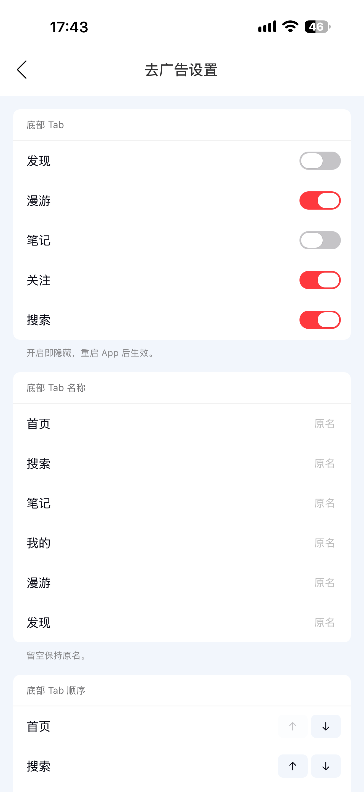
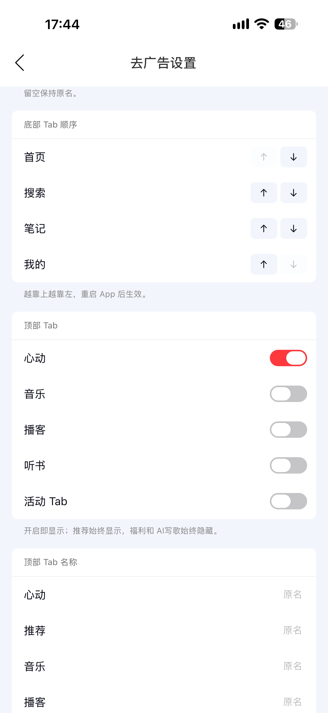
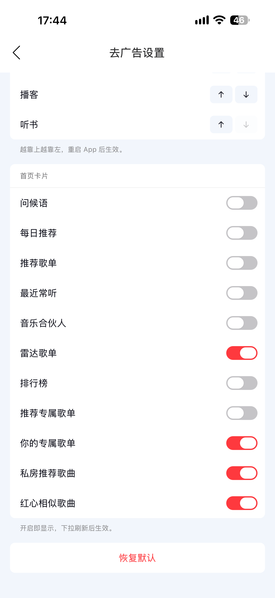

# 网易云音乐去广告

## 订阅地址

### Surge / Egern 模块

https://raw.githubusercontent.com/Yu9191/NeteasemusicAd/main/wyy.sgmodule

### Quantumult X 远程重写

https://raw.githubusercontent.com/Yu9191/NeteasemusicAd/main/wyy.quanx.conf

### Loon 插件

https://raw.githubusercontent.com/Yu9191/NeteasemusicAd/main/wyy.lpx

### 其他平台（Stash / Shadowrocket 等）

请用 [Script-Hub](https://github.com/Script-Hub-Org/Script-Hub/wiki) 把上面的 `.sgmodule` 转换为目标平台格式后订阅。

### BoxJS 订阅（三端通用配置面板）

https://raw.githubusercontent.com/Yu9191/NeteasemusicAd/main/wyy.boxjs.json

## App 内设置

安装后，网易云音乐侧边栏里「创作者中心」下面会多出「去广告设置」入口（原来的「AI写歌」入口同时隐藏）。点进去就能直接开关底部 / 顶部 Tab 和首页卡片、给底部 / 顶部 Tab 改名、调整它们的左右顺序，修改自动保存，不用再打开 BoxJS 或到模块里改参数。

页面里保存的值与 BoxJS 共用，优先级最高；点「恢复默认」即可回到模块 / 插件里的默认参数。

  
  
  

## 致敬开源

- 感谢原作者 [@Keywos](https://github.com/Keywos)
- [@nsnanocat/util](https://github.com/NSNanoCat/util) / [@nsnanocat/template](https://github.com/NSNanoCat/Template) — 跨平台脚本宿主适配

感谢上游作者的辛勤付出。

## 免责声明

本项目仅供学习交流使用，请在合法合规的前提下使用，并在下载后 24 小时内删除。
所有内容与网易云音乐及其关联公司无关，使用产生的任何后果由使用者自行承担。

## License

MIT
